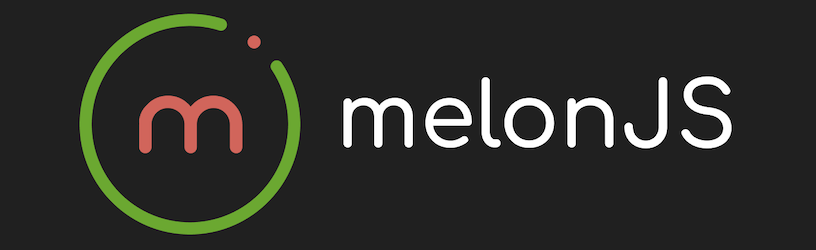

<p align="center">
  
</p>

<p align="center">
  <em>A modern, plugin-free HTML5 game engine</em>
</p>

<p align="center">
  <a href="https://www.npmjs.com/package/melonjs"></a>
  <a href="https://bundlejs.com/?q=melonjs"></a>
  <a href="https://discord.gg/aur7JMk"></a>
</p>

---

## Quick Start

```bash
npm install melonjs
```

```javascript
import { Application, Sprite, loader } from "melonjs";

// create a new melonJS application
const app = new Application(1218, 562, {
    parent: "screen",
    scale: "auto",
    backgroundColor: "#202020",
});

// initialize it (builds the renderer and appends the canvas)
await app.init();

// load and add a sprite
loader.preload([{ name: "player", type: "image", src: "player.png" }], () => {
    app.world.addChild(new Sprite(609, 281, { image: "player" }));
});
```

> **Note:** since version 20.0, `await app.init()` is **required** after constructing the `Application`. The WebGPU backend, which `AUTO` tries first where available, acquires its GPU device asynchronously; the call resolves without suspending on the WebGL and Canvas backends.

## Features

| Feature | Description |
|---------|-------------|
| **Rendering** | WebGPU, WebGL 2 and Canvas 2D with automatic fallback — the same feature set on both GPU backends, with Canvas as the fallback (custom shaders, HDR and the pixelate transition need a GPU backend) |
| **3D** | Perspective {@link Camera3d | Camera3d} with distance fog, meshes with normal maps, emissive and transparent materials, mesh instancing, `Sprite3d` billboards, ground shadows, point and spot lights, glTF/GLB and OBJ/MTL loading |
| **Tiled Maps** | First-class [Tiled](https://www.mapeditor.org/) map editor support (TMX/JSON): orthogonal, isometric and hexagonal maps, with GPU-accelerated tile rendering for orthogonal maps |
| **Sprites** | Texture atlas, animation with frame callbacks, nine-slice scaling, TexturePacker & Aseprite support, automatic depth sorting |
| **Text** | `Text` and `BitmapText`, with a typewriter effect, per-glyph wave, shake and color effects, gradient fills and outlines |
| **Camera** | Several cameras at once (split screen, minimaps) with per-camera visibility layers, follow with a deadzone and damping, shake, fade and flash, and screen transitions (fade, mask, pixelate) |
| **Lighting** | `Light2d` with normal-mapped sprites, and `Light3d` directional, point, spot and ambient lights, up to 32 at once |
| **Physics** | Built-in SAT collision with gravity, per-shape collision settings and shape-level collision events, and a {@link PhysicsAdapter | PhysicsAdapter} interface for Box2D (planck), Matter.js or Rapier, switchable while the game runs with `world.setAdapter()` |
| **Audio** | Web Audio API with format fallback, spatial audio that follows a renderable, audio sprites, plus procedural tone and noise generation |
| **Input** | Keyboard, mouse, touch, gamepad (with vibration), drag and drop |
| **Assets** | An awaitable loader with progress, asset bundles loaded and freed together, and custom asset types |
| **Particles** | Configurable {@link ParticleEmitter | ParticleEmitter}: sprite-sheet frames, tint over life, 3D emission, and a reference space so particles can be measured from the emitter, the world, or any container |
| **Effects** | All thirteen CSS blend modes on every renderer, tinting, masking, and camera post-processing chains |
| **HDR** | Optional half-float render targets (`hdr`), {@link BloomEffect | BloomEffect} and {@link ToneMappingEffect | ToneMappingEffect}, and extended-range presentation on WebGPU (`hdrOutput`). All off by default |
| **Custom Shaders** | Per-sprite {@link ShaderEffect | ShaderEffect} carrying both GLSL and WGSL, so one effect runs on either GPU backend; custom mesh shaders; screen-space effects from a capture of the frame |
| **UI** | Buttons, panels that lay out and scroll their children, checkboxes and radio buttons, sliders, progress bars, drag and drop, and keyboard and gamepad navigation between widgets |

## Official Plugins

Each plugin is published separately. Its API is documented here alongside the
engine, and each entry carries that package's own README.

| Plugin | Package | Reference |
|--------|---------|-----------|
| **Matter physics** | `@melonjs/matter-adapter` | {@link MatterAdapter | MatterAdapter} |
| **Box2D physics** | `@melonjs/planck-adapter` | {@link PlanckAdapter | PlanckAdapter} |
| **Rapier physics** | `@melonjs/rapier2d-adapter` | {@link RapierAdapter | RapierAdapter} |
| **Spine animation** | `@melonjs/spine-plugin` | {@link SpinePlugin | SpinePlugin} |
| **Debug panel** | `@melonjs/debug-plugin` | {@link DebugPanelPlugin | DebugPanelPlugin} |
| **Touch controls** | `@melonjs/gamepad-plugin` | {@link GamepadPlugin | GamepadPlugin} |
| **Compressed Tiled maps** | `@melonjs/tiled-inflate-plugin` | {@link TiledInflatePlugin | TiledInflatePlugin} |
| **Capacitor / native** | `@melonjs/capacitor-plugin` | {@link CapacitorPlugin | CapacitorPlugin} |

## Common Tasks

#### Load a level from a Tiled map
Load a level created with the [Tiled](https://www.mapeditor.org/) map editor. melonJS supports orthogonal, isometric, and hexagonal maps with multiple layers, animated tiles, and collision shapes.
```javascript
import { level } from "melonjs";

// load a level by name (must be preloaded first)
level.load("myLevel");
```
See: {@link level.load | level}, {@link TMXTileMap | TMXTileMap}

#### Create a sprite with animations
Create a sprite from a texture atlas (e.g. exported from TexturePacker or Aseprite) and define animation sequences from named frames.
```javascript
import { Sprite, TextureAtlas, loader } from "melonjs";

// create a texture atlas from preloaded JSON + image
const atlas = new TextureAtlas(loader.getJSON("atlas"), loader.getImage("atlas"));

// create a sprite with animation frames from the atlas
const player = new Sprite(100, 100,
    atlas.getAnimationSettings(["walk01.png", "walk02.png", "walk03.png"])
);
```
See: {@link Sprite | Sprite}, {@link TextureAtlas | TextureAtlas}

#### Handle keyboard and gamepad input
Bind physical keys or gamepad buttons to named actions, then check those actions in your game logic.
```javascript
import { input } from "melonjs";

// bind the spacebar and gamepad button to a "jump" action
input.bindKey(input.KEY.SPACE, "jump");

// check if the action is active (e.g. in an update loop)
if (input.isKeyPressed("jump")) {
    // make the player jump
}
```
See: {@link input | input}

#### Add physics and collision to a game object
Declare a physics body with a collision shape on any renderable. It is built when the renderable is added to the world, by whichever physics adapter is active, and the engine handles gravity, velocity, friction, and collision detection automatically.
```javascript
import { Rect, collision } from "melonjs";

// declare the body (built on addChild, on any physics adapter)
this.bodyDef = {
    type: "dynamic",
    shapes: [new Rect(0, 0, 32, 32)],
    // so the engine knows how to handle collisions
    collisionType: collision.types.PLAYER_OBJECT,
    // movement limits and friction
    maxVelocity: { x: 3, y: 15 },
    frictionAir: { x: 0.4, y: 0 },
};
```
See: {@link BodyDefinition | BodyDefinition}, {@link collision | collision}

#### Apply a custom shader effect to a sprite
Apply a per-sprite fragment shader using `ShaderEffect`. You only need to write the color transformation — the vertex shader and texture sampling are handled automatically. Runs on both GPU backends — write the body once and it is realized as GLSL or WGSL for the active renderer — and is silently ignored in Canvas mode.
```javascript
import { ShaderEffect } from "melonjs";

// apply a grayscale effect to a sprite
mySprite.addPostEffect(new ShaderEffect(renderer, `
    vec4 apply(vec4 color, vec2 uv) {
        float gray = dot(color.rgb, vec3(0.299, 0.587, 0.114));
        return vec4(vec3(gray), color.a);
    }
`));
```
See: {@link ShaderEffect | ShaderEffect}, {@link Renderable.addPostEffect | addPostEffect}

## Using this reference with an AI assistant

Three things here are meant for assistants as much as for people.

**`llms.txt`** — [melonjs.github.io/melonJS/llms.txt](https://melonjs.github.io/melonJS/llms.txt)
indexes every exported class, function, interface and type with a one-line
summary and a link to its page, and marks the deprecated ones. It is
regenerated on every docs build, so it never drifts from the release. Point an
assistant at that single URL rather than asking it to guess an API name.

**Copy page** — the button in the header above copies the page you are reading
as Markdown, with its canonical URL attached, or hands it straight to an
assistant. Useful when you want to ask about one class without the model
fetching half the reference.

**Skills** — the engine ships guidance files that teach an assistant its
conventions, and more usefully the mistakes that fail *silently* rather than
raising an error: a custom `draw()` that ignores `this.pos`, `isKinematic`
blocking pointer events, `.z` set after `addChild`. They are versioned with the
engine, so a copy matching your exact release always ships inside the package.

Install them into whatever assistant you use, with one command:

```bash
npx skills add https://github.com/melonjs/melonJS/tree/master/packages/melonjs/skills
```

It installs one copy of each skill under `.agents/skills/<skill-name>`, then
symlinks that copy into every assistant's own directory, so
`.claude/skills/melonjs` points back at `.agents/skills/melonjs` and there is
nothing to place by hand. It reports the assistants it covers as it runs (77 of
them at the time of writing). It installs from `master`; swap that for a release
tag in the URL to pin.

They are plain Markdown — readable by any agent, or by you.

## Links

- [Live Examples](https://melonjs.github.io/melonJS/examples/)
- [Official Plugins](#official-plugins)
- [GitHub Repository](https://github.com/melonjs/melonJS)
- [Discord Community](https://discord.gg/aur7JMk)
- [melonjs.org](http://www.melonjs.org/)
