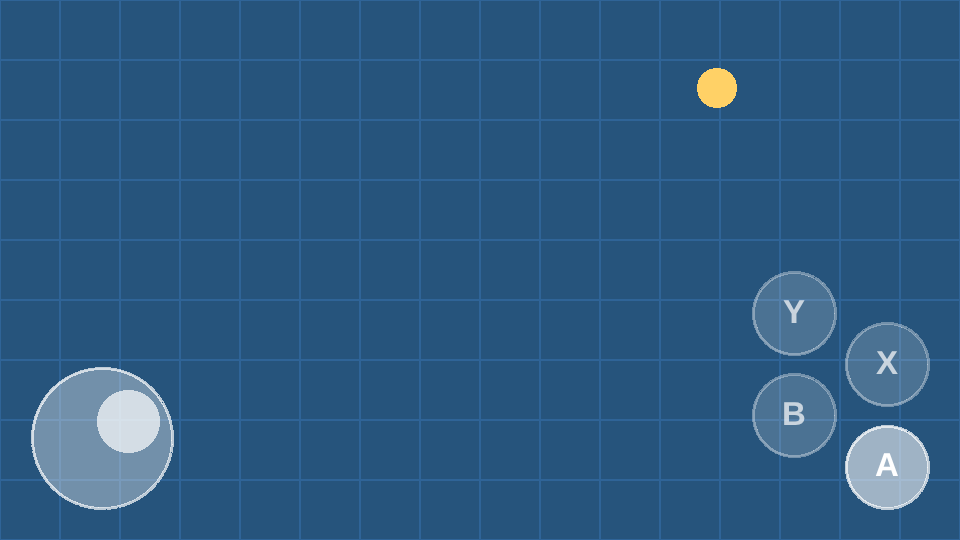

# melonJS Gamepad Plugin


[](https://github.com/melonjs/melonJS/blob/master/LICENSE)
[](https://www.npmjs.com/package/@melonjs/gamepad-plugin)

On-screen touch controls for [melonJS](https://melonjs.org/) games, reported as a gamepad.



The sticks and buttons are drawn over the game and read by the engine as a pad in a gamepad slot, so everything a game binds with `input.bindGamepad` answers to them. One set of bindings covers a real pad and the touch controls.

- one or two sticks, analog, with a deadzone, and pressing the D-pad in 8 directions
- any number of buttons, each pressing a pad button or a key, that a game can relabel, dim or hide
- each finger followed on its own: hold the stick and press a button at the same time
- a touch that starts on the controls does not reach the game
- drawn over the whole frame, above every renderable and every camera (a minimap does not show them), and kept across stage changes
- drawn with the renderer's own shapes: no images to load
- hidden while the player uses a real pad, and back on the next touch
- a light vibration on each button press, as a real button gives, and `input.vibrateGamepad` vibrating the phone, where the browser can (Android, not iOS)

## Install

```sh
npm install melonjs @melonjs/gamepad-plugin
```

It needs melonJS 20.12 or later.

## Quick start

```ts
import { Application, input, plugin } from "melonjs";
import { GamepadPlugin } from "@melonjs/gamepad-plugin";

const app = new Application(1024, 768, { parent: "screen", scaleMethod: "flex" });
await app.init();

// a stick and two buttons, shown on touch screens
plugin.register(GamepadPlugin, "gamepad", {
	buttons: [{ label: "A" }, { label: "B" }],
});

// the game binds the pad as it would a real one
input.bindKey(input.KEY.LEFT, "left");
input.bindKey(input.KEY.RIGHT, "right");
input.bindKey(input.KEY.X, "jump", true);
input.bindGamepad(0, { type: "buttons", code: input.GAMEPAD.BUTTONS.LEFT }, input.KEY.LEFT);
input.bindGamepad(0, { type: "buttons", code: input.GAMEPAD.BUTTONS.RIGHT }, input.KEY.RIGHT);
input.bindGamepad(0, { type: "buttons", code: input.GAMEPAD.BUTTONS.FACE_1 }, input.KEY.X);
```

The stick presses the D-pad buttons as it leans, and reports its analog position on `GAMEPAD.AXES.LX` and `LY`, which a game can bind with a `threshold` or read on `event.GAMEPAD_UPDATE`. The first button presses `FACE_1`, the second `FACE_2`, and so on.

A game that reads the keyboard only can have the controls press keys instead:

```ts
plugin.register(GamepadPlugin, "gamepad", {
	sticks: [{ keys: { left: input.KEY.LEFT, right: input.KEY.RIGHT } }],
	buttons: [{ key: input.KEY.SPACE, label: "Jump" }],
});
```

## Options

| Option | Default | |
| --- | --- | --- |
| `enabled` | `device.touch` | show the controls: by default on any touch screen, touch laptops included |
| `index` | `0` | the gamepad slot they report in |
| `sticks` | `1` | how many sticks (0 to 2), or a list of [stick options](#sticks) |
| `buttons` | `1` | how many buttons, or a list of [button options](#buttons) |
| `hideOnGamepad` | `true` | hide them while a real pad is in use |
| `color` | `"#ffffff"` | their color |
| `opacity` | `0.35` | how opaque they are at rest; a press doubles it |
| `margin` | 6% of the shorter side | the space kept from the edges of the viewport |
| `vibrate` | `true` | let `input.vibrateGamepad` vibrate the phone |
| `haptics` | `10` | how long a button press vibrates, in milliseconds, for the feel of a real button; `0` for none |

Sizes and positions are in viewport pixels, the same units the game is drawn in. The controls keep their place when the viewport is resized or turned.

### Sticks

| Option | Default | |
| --- | --- | --- |
| `side` | `"left"`, then `"right"` | the left stick reports `LX`/`LY`, the right one `RX`/`RY` |
| `position` | its bottom corner | `{ left or right, top or bottom }`: from the edges to its center |
| `radius` | 13% of the shorter side | the radius of its base |
| `floating` | `false` | centered where the thumb lands on its half of the screen |
| `deadzone` | `0.1` | how far it must lean (0 to 1) before it reads anything |
| `dpad` | on for the left stick | press the D-pad buttons in 8 directions |
| `dpadThreshold` | `0.5` | how far the thumb must travel (0 to 1) to press the D-pad and its `keys`; lower for a stick that answers sooner |
| `keys` | none | `{ up, down, left, right }`: keys to press as it leans |

### Buttons

| Option | Default | |
| --- | --- | --- |
| `button` | `FACE_1`, `FACE_2`… | the pad button it presses; `null` for none |
| `key` | none | a key to press, instead of a pad button unless `button` is also given |
| `label` | none | the text on it |
| `position` | gathered in the bottom-right corner | from the edges to its center |
| `radius` | 7.5% of the shorter side | its radius |

With a second stick, the buttons gather above it.

## At run time

```ts
const gamepad = plugin.cache.gamepad as GamepadPlugin;

// a stage that only needs a tap
gamepad.enabled = false;

// light the use button only when there is something in reach
gamepad.buttons[1].dimmed = !nearSomething;
gamepad.buttons[1].label = "Open";
gamepad.buttons[1].visible = false;

// word a prompt for the player's controls
const prompt = gamepad.visible ? "Tap A to start" : "Press X to start";
```

- `enabled`: switches the controls on and off
- `visible`: whether they are on the screen, which is `enabled` and not hidden for a real pad
- `sticks[i]`: a stick's `value` (`x`, `y` from -1 to 1), `center` and `radius`
- `buttons[i]`: a button's `pressed`, and its `label`, `dimmed` and `visible`, which can be set
- `destroy()`: takes the controls off the screen and out of their slot for good

## Hidden for a real pad

With `hideOnGamepad` (on by default) the controls hide as soon as the player uses a real pad, a button pressed or a stick pushed, and come back when the screen is touched or the pad is unplugged. Any pad counts, whatever its slot.

A real pad and the touch controls can share a slot: the engine reads both, and either one presses a button.

## Troubleshooting

| Symptom | Cause |
| --- | --- |
| The controls do not show | `enabled` defaults to `device.touch`, false without a touch screen: pass `enabled: true` to try them on a desktop. They also hide while a real pad is in use |
| Touch controls do nothing | Nothing is bound to their slot: bind with `input.bindGamepad(index, ...)` on the plugin's `index` (0 by default), or use `key` options |
| The stick moves but nothing walks | Nothing is bound to what the stick reports: its axes (`LX`, `LY`), or the D-pad buttons, which only the left stick presses by default |
| `gamepad 0 already holds a virtual gamepad` | Two sets of controls in one slot: give the second one another `index` |

## Developing

`pnpm -F @melonjs/gamepad-plugin visual` serves a visual test page, with the controls over a small scene and toggles for each feature, to try on a desktop or a phone: see [`visual/README.md`](visual/README.md). `pnpm -F @melonjs/gamepad-plugin test` runs the tests.

## License

MIT
