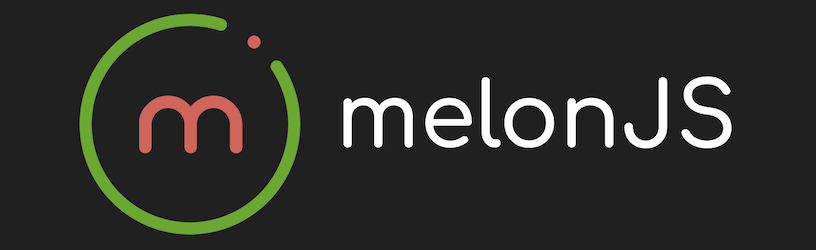
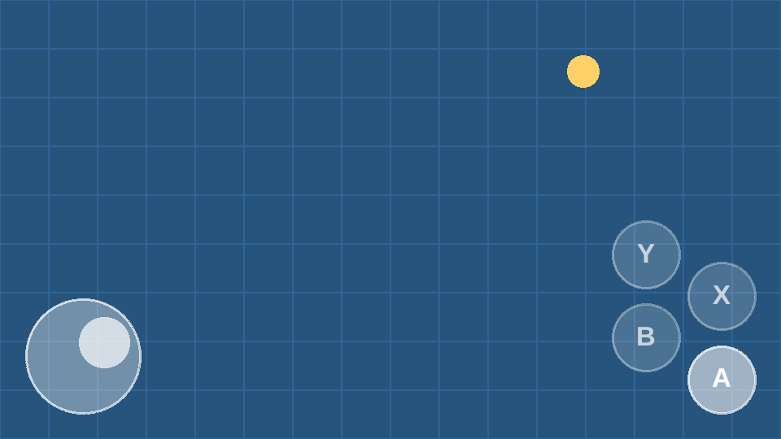

# melonJS Gamepad Plugin


[](https://github.com/melonjs/melonJS/blob/master/LICENSE)
[](https://www.npmjs.com/package/@melonjs/gamepad-plugin)

On-screen touch controls for [melonJS](https://melonjs.org/) games, reported as a gamepad.



The sticks and buttons are drawn over the game and read by the engine as a pad in a gamepad slot, so everything a game binds with `input.bindGamepad` answers to them. One set of bindings covers a real pad and the touch controls.

- one or two sticks, analog, with a deadzone, and pressing the D-pad in 8 directions
- sticks fixed in a corner, or floating: appearing under the thumb wherever it lands, on its half of the screen, anywhere, or in a zone of your choosing
- buttons fixed in place, or floating: pressed wherever a finger lands in their area and drawn under it
- a quick tap on a stick can press a button or a key, so one thumb both steers and acts, with no button on the screen
- any number of buttons, each pressing a pad button or a key, that a game can relabel, dim or hide
- each finger followed on its own: hold the stick and press a button at the same time
- every press lasts at least one frame, so even the quickest tap reaches the game
- two thumbs at once on iOS too: Safari's pinch gesture is kept from taking the second finger
- a touch that starts on the controls does not reach the game
- drawn over the whole frame, above every renderable and every camera (a minimap does not show them), and kept across stage changes
- drawn with the renderer's own shapes: no images to load
- hidden while the player uses a real pad, and back on the next touch
- a light vibration on each button press, as a real button gives, and `input.vibrateGamepad` vibrating the phone, where the browser supports it

## Install

```sh
npm install melonjs @melonjs/gamepad-plugin
```

It needs melonJS 20.12 or later.

## Quick start

```ts
import { Application, input, plugin } from "melonjs";
import { GamepadPlugin } from "@melonjs/gamepad-plugin";

const app = new Application(1024, 768, { parent: "screen", scaleMethod: "flex" });
await app.init();

// a stick and two buttons, shown on touch screens
plugin.register(GamepadPlugin, "gamepad", {
	buttons: [{ label: "A" }, { label: "B" }],
});

// the game binds the pad as it would a real one
input.bindKey(input.KEY.LEFT, "left");
input.bindKey(input.KEY.RIGHT, "right");
input.bindKey(input.KEY.X, "jump", true);
input.bindGamepad(0, { type: "buttons", code: input.GAMEPAD.BUTTONS.LEFT }, input.KEY.LEFT);
input.bindGamepad(0, { type: "buttons", code: input.GAMEPAD.BUTTONS.RIGHT }, input.KEY.RIGHT);
input.bindGamepad(0, { type: "buttons", code: input.GAMEPAD.BUTTONS.FACE_1 }, input.KEY.X);
```

The stick presses the D-pad buttons as it leans, and reports its analog position on `GAMEPAD.AXES.LX` and `LY`, which a game can bind with a `threshold` or read on `event.GAMEPAD_UPDATE`. The first button presses `FACE_1`, the second `FACE_2`, and so on.

A game that reads the keyboard only can have the controls press keys instead:

```ts
plugin.register(GamepadPlugin, "gamepad", {
	sticks: [{ keys: { left: input.KEY.LEFT, right: input.KEY.RIGHT } }],
	buttons: [{ key: input.KEY.SPACE, label: "Jump" }],
});
```

## Options

| Option | Default | |
| --- | --- | --- |
| `enabled` | `device.touch` | show the controls: by default on any touch screen, touch laptops included |
| `index` | `0` | the gamepad slot they report in |
| `sticks` | `1` | how many sticks (0 to 2), or a list of [stick options](#sticks) |
| `buttons` | `1` | how many buttons, or a list of [button options](#buttons) |
| `hideOnGamepad` | `true` | hide them while a real pad is in use |
| `color` | `"#ffffff"` | their color |
| `opacity` | `0.35` | how opaque they are at rest; a press doubles it |
| `margin` | 6% of the shorter side | the space kept from the edges of the viewport |
| `vibrate` | `true` | let `input.vibrateGamepad` vibrate the phone |
| `haptics` | `10` | how long a button press vibrates, in milliseconds, for the feel of a real button; `0` for none |

Sizes and positions are in viewport pixels, the same units the game is drawn in. The controls keep their place when the viewport is resized or turned.

### Sticks

| Option | Default | |
| --- | --- | --- |
| `side` | `"left"`, then `"right"` | the left stick reports `LX`/`LY`, the right one `RX`/`RY` |
| `position` | its bottom corner | `{ left or right, top or bottom }`: from the edges to its center |
| `radius` | 13% of the shorter side | the radius of its base |
| `floating` | `false` | centered where the thumb lands, inside its `area` |
| `area` | `"half"` | where a floating stick can be picked up: `"half"`, its half of the screen; `"screen"`, anywhere; or `{ x, y, width, height }` in viewport pixels. See [where controls overlap](#where-controls-overlap) |
| `hideAtRest` | `false` | draw a floating stick only while a finger holds it, so it appears under the thumb and goes when the thumb lifts |
| `tap` | none | `{ button, key, time }`: a quick tap that does not steer presses this pad button (`FACE_1` by default, none when `key` is given) or this key, for one frame. A tap lifts within `time` ms (250) and never leans as far as `dpadThreshold`; a cancelled touch is not one. A fading ring marks where it landed |
| `deadzone` | `0.1` | how far it must lean (0 to 1) before it reads anything |
| `dpad` | on for the left stick | press the D-pad buttons in 8 directions |
| `dpadThreshold` | `0.5` | how far the thumb must travel (0 to 1) to press the D-pad and its `keys`; lower for a stick that answers sooner |
| `keys` | none | `{ up, down, left, right }`: keys to press as it leans |

### Buttons

| Option | Default | |
| --- | --- | --- |
| `button` | `FACE_1`, `FACE_2`… | the pad button it presses; `null` for none |
| `key` | none | a key to press, instead of a pad button unless `button` is also given |
| `label` | none | the text on it |
| `position` | gathered in the bottom-right corner | from the edges to its center |
| `radius` | 7.5% of the shorter side | its radius |
| `floating` | `false` | pressed wherever a finger lands inside its `area`, and drawn under that finger while held; it rests at its `position` |
| `area` | `"half"` | where a floating button can be pressed: `"half"`, the half of the screen its `position` is on; `"screen"`, anywhere; or `{ x, y, width, height }` in viewport pixels. See [where controls overlap](#where-controls-overlap) |
| `hideAtRest` | `false` | draw a floating button only while a finger holds it; let go, it fades where it was |

With a second stick, the buttons gather above it.

### Floating controls

A floating stick or button has no fixed spot: it shows up under the finger wherever that lands inside its `area`, follows it while held, and goes back to its `position` when let go. With `hideAtRest` it is not drawn at all until touched, as in most mobile games.

The two-thumb layout: the left thumb steers anywhere on the left half, the right thumb fires anywhere on the right half, and neither shows until touched.

```ts
plugin.register(GamepadPlugin, "gamepad", {
	sticks: [{ floating: true, hideAtRest: true }],
	buttons: [{ floating: true, hideAtRest: true, label: "A" }],
});
```

A stick that appears anywhere, with a button that keeps its corner:

```ts
plugin.register(GamepadPlugin, "gamepad", {
	sticks: [{ floating: true, area: "screen", hideAtRest: true }],
	buttons: [{ label: "A" }],
});
```

Or no button at all: drag anywhere to steer, tap anywhere to act.

```ts
plugin.register(GamepadPlugin, "gamepad", {
	sticks: [{ floating: true, area: "screen", hideAtRest: true, tap: { key: input.KEY.SPACE } }],
	buttons: 0,
});
```

`area` can also keep a floating control to part of the screen, the lower half under a board say: `area: { x: 0, y: 512, width: 576, height: 512 }`.

#### Where controls overlap

A finger landing takes the first control that is free there, in this order:

1. fixed buttons
2. fixed sticks
3. floating buttons
4. floating sticks

So a fixed button is always a button, and a floating button whose area lies inside a floating stick's carves that part out of the stick's: with the stick on `"screen"` and the button on its `"half"`, the button owns the right half and the stick the rest. A floating control takes one finger at a time: a second finger in its area falls through to the next control in the list.

Several floating buttons can share an area, the right half by default: a finger landing there presses the one that rests nearest to it, so each owns the part of the area around its `position`, and two fingers can hold two of them at once. A finger nearest to a button already held presses no other button; it falls through to a floating stick, if any. For fixed zones instead, give each its own `area`, top and bottom of the right half say:

```ts
buttons: [
	{ floating: true, label: "A", area: { x: 288, y: 512, width: 288, height: 512 } },
	{ floating: true, label: "B", area: { x: 288, y: 0, width: 288, height: 512 } },
],
```

With `hideAtRest` the players cannot see where buttons rest, so give buttons that share an area visible resting spots, or their own areas.

#### Quick taps

A press lasts until a frame has seen it, however quick the tap: a thumb tapping in 15 ms, quicker than a frame, still presses the button for that frame, where it would otherwise press and let go between two updates and never reach the game. A press a frame has already seen lets go at once.

## At run time

```ts
const gamepad = plugin.cache.gamepad as GamepadPlugin;

// a stage that only needs a tap
gamepad.enabled = false;

// light the use button only when there is something in reach
gamepad.buttons[1].dimmed = !nearSomething;
gamepad.buttons[1].label = "Open";
gamepad.buttons[1].visible = false;

// word a prompt for the player's controls
const prompt = gamepad.visible ? "Tap A to start" : "Press X to start";
```

- `enabled`: switches the controls on and off
- `visible`: whether they are on the screen, which is `enabled` and not hidden for a real pad
- `sticks[i]`: a stick's `value` (`x`, `y` from -1 to 1), `center` (under the thumb while a floating stick is held) and `radius`; `tapping`, true for the frame a tap presses its button; and the options it was made with, `floating`, `area` and `hideAtRest`
- `buttons[i]`: a button's `pressed` (while a finger is on it, and for at least one frame), `center` (under the finger while a floating button is held), and its `label`, `dimmed` and `visible`, which can be set; and the options it was made with, `floating`, `area` and `hideAtRest`
- `destroy()`: takes the controls off the screen and out of their slot for good

## Hidden for a real pad

With `hideOnGamepad` (on by default) the controls hide as soon as the player uses a real pad, a button pressed or a stick pushed, and come back when the screen is touched or the pad is unplugged. Any pad counts, whatever its slot.

A real pad and the touch controls can share a slot: the engine reads both, and either one presses a button.

## On iOS

Two fingers down start Safari's own pinch gesture, even over a canvas with `touch-action: none`, and while it runs it can take the second finger, so a thumb holding a stick would only sometimes let the other press a button. While the controls show, the plugin cancels Safari's `gesturestart`, `gesturechange` and `gestureend`, which keeps both fingers for the game; it lets them through again while the controls are hidden or switched off.

## Troubleshooting

| Symptom | Cause |
| --- | --- |
| The controls do not show | `enabled` defaults to `device.touch`, false without a touch screen: pass `enabled: true` to try them on a desktop. They also hide while a real pad is in use |
| Touch controls do nothing | Nothing is bound to their slot: bind with `input.bindGamepad(index, ...)` on the plugin's `index` (0 by default), or use `key` options |
| The stick moves but nothing walks | Nothing is bound to what the stick reports: its axes (`LX`, `LY`), or the D-pad buttons, which only the left stick presses by default |
| `gamepad 0 already holds a virtual gamepad` | Two sets of controls in one slot: give the second one another `index` |
| A floating stick does not answer on the right half | Its `area` is `"half"` by default, its own side: use `area: "screen"` |
| A floating stick with `area: "screen"` does not answer on the right half | A floating button's area comes first there, the right half by default: that part is the button's, see [where controls overlap](#where-controls-overlap) |
| A tap on a stick moves the player instead of acting | It leaned past `dpadThreshold` before lifting, or lasted longer than `tap.time`: raise either |

## Developing

`pnpm -F @melonjs/gamepad-plugin visual` serves a visual test page, with the controls over a small scene and toggles for each feature, to try on a desktop or a phone: see [`visual/README.md`](visual/README.md). `pnpm -F @melonjs/gamepad-plugin test` runs the tests.

## License

MIT
