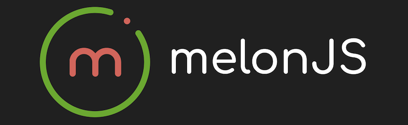

# @melonjs/planck-adapter



[](https://github.com/melonjs/melonJS/blob/master/LICENSE)
[](https://www.npmjs.com/package/@melonjs/planck-adapter)

A [planck.js](https://piqnt.com/planck.js/) physics adapter for melonJS — drops in for the built-in SAT physics and gives you Box2D's rigid-body simulation, continuous collision detection, rotational dynamics, sleeping bodies, joints, and raycasting.

Planck is a faithful JavaScript/TypeScript port of [Box2D](https://box2d.org/) 2.3.0 — the same simulator behind Angry Birds, Limbo, and many of the touch-era classic mobile platformers. It is a sync, zero-WASM, MIT-licensed library that ships as plain ES modules.

**Per-object collision dispatch is already wired up.** Every `Renderable` receives `onCollisionStart(response, other)`, `onCollisionActive(response, other)`, and `onCollisionEnd(response, other)` callbacks — the same shape you use under the built-in adapter or `@melonjs/matter-adapter`. No rewrite, no contact-list firehose to filter yourself.

## Installation

```bash
npm install @melonjs/planck-adapter
```

`planck` is a regular dependency of the adapter, so it is installed with it and you don't need to install it yourself. The only peer dependency is `melonjs` 20.0 or later, which provides the `PhysicsAdapter` interface this package implements.

> **Node 24+** is required at install time — `planck` itself declares `engines.node: ">=24.0"` and this constraint flows through. The runtime is the browser, so this only affects the build/install toolchain. If you're on an older Node version, your package manager will warn (npm) or refuse (pnpm with `engine-strict`).

## Usage

Create the adapter with `PlanckAdapter.create()` and pass it as the `physic` option when constructing your `Application`:

```ts
import { PlanckAdapter } from "@melonjs/planck-adapter";
import { Application, video } from "melonjs";

const app = new Application(800, 600, {
    parent: "screen",
    renderer: video.AUTO,
    physic: await PlanckAdapter.create({
        gravity: { x: 0, y: 320 },
    }),
});

// mandatory since melonJS 20.0: the renderer is built here
await app.init();
```

That's it — every renderable that declares a `bodyDef` gets registered with planck automatically on `Container.addChild`, and the rest of your game code (collision handlers, velocity reads, gravity tweaks, etc.) talks to the shared `PhysicsAdapter` interface so it works with either adapter.

`create()` is the form every melonJS physics adapter shares (see `PhysicsAdapterClass` in the melonJS API): it waits for the adapter's `load()`, then constructs it, so the same line works for an adapter whose engine is WebAssembly and has to be downloaded first. planck is plain JavaScript and needs no loading, so here `load()` resolves at once and `new PlanckAdapter({ ... })` does exactly the same thing. It stays supported.

### Options

The options go in the `PlanckAdapter.create({ ... })` call you pass as `physic` above. They are all optional; this is that call with each one at its default:

```ts
physic: await PlanckAdapter.create({
    gravity: { x: 0, y: 320 },  // pixels per second², ≈ 10 m/s² pulling down
    pixelsPerMeter: 32,
    subSteps: 1,
    velocityIterations: 8,      // Box2D's recommended value
    positionIterations: 3,      // Box2D's recommended value
}),
```

`gravity` can also change while the game runs: the adapter reads `app.world.adapter.gravity` at every step, so `app.world.adapter.gravity.set(0, 160)` halves it from the next one. The other options cannot change on a live adapter. To change them, switch to a new one with `app.world.setAdapter(await PlanckAdapter.create({ ... }))`, which rebuilds every body from its `bodyDef`, at rest.

#### `gravity`

Specified in **pixels per second²**, not meters. The adapter converts to meters internally using `pixelsPerMeter`. The default `(0, 320)` ≈ 10 m/s² at `pixelsPerMeter = 32` is Earth-like gravity pulling down — adjust for arcade feel.

#### `pixelsPerMeter`

Planck (and Box2D) operates in **meters** internally; the adapter converts to/from melonJS's pixel space at every boundary (positions, velocities, gravity, forces, AABB queries). The default `32` means one 32×32 sprite is one Box2D unit — which falls inside Box2D's tuned sweet spot (0.1 – 10 m). Raising it makes every body smaller in meters, so it weighs less (mass is density × area in m²) and the same force or impulse moves it further. Motion under gravity alone looks the same in pixels. Lowering it does the opposite, and risks solver instability once bodies grow past Box2D's tuned scale. Box2D also caps how far a body moves in one step at 2 m: 64 px at the default scale, or about 3840 px/s at 60 steps a second.

Pick once at construction time and stick with it — every body in the world shares the same scale.

#### `subSteps`

Divides each physics step into `N` sub-steps of `dt / N` seconds. Box2D already sweeps a dynamic body against static and kinematic ones, so a fast body does not tunnel through a wall. Two dynamic bodies can still pass through each other at high speed, unless one of them is a bullet (see [CCD for fast objects](#ccd-for-fast-objects-planck-only)). Sub-steps help there too: bump this to `2`–`4`, at about `N` times the physics cost. The default `1` matches plain Box2D behaviour.

#### `velocityIterations` / `positionIterations`

Box2D solver iteration counts. The defaults are Box2D's recommended `8` and `3`. Increase `positionIterations` for stiffer stacks (less jitter at the cost of CPU); increase `velocityIterations` for crisper restitution between bouncing bodies.

## Collision Events

The adapter dispatches planck's two native collision events to renderable hooks, plus an active-pair pass each step:

```ts
class Player extends Sprite {
    // fires once when two bodies begin contact (planck: begin-contact)
    onCollisionStart(response, other) { /* stomp, pickup, trigger entry */ }

    // fires every frame while two bodies remain in contact (adapter walks
    // the world contact list after each step)
    onCollisionActive(response, other) { /* sustained damage, conveyor friction */ }

    // fires once when two bodies separate (planck: end-contact)
    onCollisionEnd(response, other) { /* left the platform, exited a zone */ }
}
```

Implement only the ones you need. The same three handlers also fire on the builtin SAT adapter and on `@melonjs/matter-adapter`, so handler code stays portable. A renderable without `onCollisionActive` gets the legacy `onCollision(response, other)` instead, each step while its body touches another (see the porting notes below).

The shape-level hooks, `onShapeCollisionStart`, `onShapeCollisionActive` and `onShapeCollisionEnd`, work here too. They report every overlapping pair of shapes rather than one contact per pair of bodies: Box2D makes one contact per fixture pair, and the adapter builds one fixture per shape. Each contact names both shapes and their indices, and carries `normal` and `depth` like the `response` below.

### The `response` object

The first argument passed to every collision hook is:

```ts
response = {
    a:      Renderable,                 // this renderable (the one whose handler is firing)
    b:      Renderable,                 // the other renderable
    normal: { x: number, y: number },   // unit MTV for `a` (direction to escape)
    depth:  number,                     // penetration depth in pixels (never negative)
    pair:   planck.Contact,             // raw planck Contact (manifold, points, fixtures, …)
}
```

**`normal` direction** — the minimum-translation vector *for the receiver*. It points in the direction `this` (a.k.a. `response.a`) must move to separate from `other`. Each side of the dispatch sees its own MTV, so the normals on the two handlers are mirrored.

In canvas coordinates (y grows downward):

- `normal.y < -0.7` → push me **up** to escape ⇒ I'm sitting on top of `other` (classic stomp / landing).
- `normal.y >  0.7` → push me **down** to escape ⇒ I'm underneath (head-bumped a ceiling, got stomped on).
- `Math.abs(normal.x) > 0.7` → mostly horizontal contact ⇒ side hit.

A contact with no contact points has no normal: a sensor contact, and a contact in `onCollisionEnd` once the bodies have separated. There `normal` is `(0, 0)` and `depth` is `0`.

`response.pair` is planck's native `Contact` (with `getFixtureA()`, `getFixtureB()`, `getManifold()`, `getWorldManifold()`, etc.) for advanced use. `normal` is the world manifold's normal, and `depth` is its deepest `separations` entry, converted to pixels.

## Body helper methods

The canonical portable surface is the `PhysicsAdapter` interface: every method below except `setMass` and `setBounce` is also reachable as `adapter.X(renderable, ...)`. As a convenience this adapter bolts the portable operations onto `renderable.body` so the idiomatic form available on built-in `me.Body` works here too:

```ts
// Linear kinematics — spliced onto body (planck.Body has no equivalent)
body.setVelocity(x, y)                       // ⇔ adapter.setVelocity(renderable, { x, y })
body.getVelocity(out?)                       // ⇔ adapter.getVelocity(renderable, out)
body.applyForce(x, y)                        // ⇔ adapter.applyForce(renderable, { x, y })
body.applyForce(x, y, pointX, pointY)        // off-centre ⇒ generates torque (planck native lever-arm)
body.applyImpulse(x, y)                      // ⇔ adapter.applyImpulse(renderable, { x, y })

// Angular kinematics — NATIVE on planck.Body, reused as-is
body.setAngle(rad)                           // planck.Body.setAngle / adapter.setAngle
body.getAngle()                              // planck.Body.getAngle  / adapter.getAngle
body.setAngularVelocity(omega)               // planck.Body.setAngularVelocity / adapter.setAngularVelocity
body.getAngularVelocity()                    // planck.Body.getAngularVelocity / adapter.getAngularVelocity
body.applyTorque(t)                          // planck.Body.applyTorque / adapter.applyTorque

// Body state — spliced helpers wrap planck's per-fixture / mass-data APIs
body.setSensor(isSensor?)                    // toggles every fixture's sensor flag
body.setStatic(isStatic?)                    // ⇔ planck.Body.setType("static" | "dynamic")
body.setMass(m)                              // wraps planck.Body.setMassData (preserves center + inertia)
body.setBounce(r)                            // sets every fixture's restitution
body.setGravityScale(s)                      // planck.Body.setGravityScale (native, same name & sig)
body.setCollisionMask(mask)                  // sets every fixture's filterMaskBits
body.setCollisionType(type)                  // sets every fixture's filterCategoryBits
```

**Units.** Velocities are in pixels per second, angles in radians, and angular velocities in radians per second. `applyImpulse` changes the velocity by `J / mass`, in px/s. `applyTorque` is a torque that acts over the next step, not an instant spin: for that, use planck's own `applyAngularImpulse` (see below).

**Implementation note:** the helpers marked "NATIVE on planck.Body" are NOT spliced — planck's class already exposes them with compatible signatures, so the `PlanckAdapter.Body` type surfaces them via the intersection. Methods like `applyForce`, `setVelocity`, and `setStatic` that DO collide with native planck signatures (or use different shapes) are spliced on top of the body, replacing the native form with the portable one. The native `planck.Body.applyForce(Vec2, Vec2, wake)` is replaced on the body itself, so the bodies `adapter.world.getBodyList()` returns have the portable form too. If you need it, use the native `applyForceToCenter(force)`, which is not replaced, or `adapter.planck.Body.prototype.applyForce.call(body, force, point, true)`. Both take meters. Prefer the portable form otherwise.

### Reaching planck-native body methods

Planck exposes a rich body API (sleeping control, mass data, CCD bullet flag, transform overrides, etc.) directly on the `planck.Body` instance. Cast to the published `PlanckAdapter.Body` type to keep type-checking happy without taking a direct `planck` import:

```ts
import { PlanckAdapter } from "@melonjs/planck-adapter";

// enable continuous collision detection for fast-moving objects (e.g. cue ball):
(ball.body as PlanckAdapter.Body).setBullet(true);

// suppress sleeping on a body that must always respond to user input:
(player.body as PlanckAdapter.Body).setSleepingAllowed(false);

// read planck-native mass:
const mass = (crate.body as PlanckAdapter.Body).getMass();
```

`PlanckAdapter.Body` is `planck.Body & PhysicsBody` — you get planck's full instance methods plus the portable helper methods, without needing to import `planck` yourself. Code that does this is planck-only by definition; for portable rotation use the angular kinematic methods above.

## Raycasting

```ts
adapter.raycast(from: Vector2d, to: Vector2d) → RaycastHit | null
```

Shoot a ray through the world and get the first body hit:

```ts
const hit = adapter.raycast(new Vector2d(0, 0), new Vector2d(800, 600));
if (hit) {
    // hit.renderable — the renderable the ray entered
    // hit.point      — world-space entry point on the body's surface
    // hit.normal     — outward-facing surface normal at the entry
    // hit.fraction   — 0..1 along the ray, from `from` to `to`
}
```

Portable — same shape under the builtin SAT adapter, `@melonjs/matter-adapter`, and this one. Implementation under planck uses Box2D's native fractional ray-cast, so curved/rotated bodies report exact-surface hit geometry rather than a body-centre approximation.

## Region queries

```ts
adapter.queryAABB(rect: Rect) → Renderable[]
```

Return every renderable whose body bounds overlap the given rectangle. Useful for area-of-effect damage, mouse / touch picking, trigger-zone sweeps, AI awareness checks. Portable — same call under builtin, matter, and planck. Under planck the implementation uses Box2D's native AABB query, which tests each fixture's broadphase box: that box is padded by 0.1 m, about 3 px at the default scale, so a body just outside the rectangle can be returned.

## Joints

`app.world.addJoint()` (melonJS 20.15 and later) joins two bodies the same way on the two adapters that have joints:

| adapter | `world.addJoint()` |
|---|---|
| `@melonjs/planck-adapter` (this one) | ✅ hinge, rope, weld, slider |
| `@melonjs/rapier2d-adapter` | ✅ hinge, rope, weld, slider |
| built-in | ❌ throws |
| `@melonjs/matter-adapter` | ❌ throws (matter's own constraints, through `adapter.matter`) |

On this adapter each joint is a Box2D joint underneath:

| `type` | planck joint | settings |
|---|---|---|
| `"hinge"` | `RevoluteJoint` | `limits`: radians, b's angle minus a's |
| `"rope"` | `RopeJoint` | `maxLength`: pixels |
| `"weld"` | `WeldJoint` | |
| `"slider"` | `PrismaticJoint` | `axis`, and `limits`: pixels along the axis |

```ts
// a door hinged at its top-left corner, opening up to 90 degrees
const hinge = app.world.addJoint({
    type: "hinge",
    a: frame,                 // both have a bodyDef and are in the world
    b: door,
    anchorA: { x: 4, y: 0 },  // pixels, in each renderable's own space (its bodyDef shapes' space)
    anchorB: { x: 0, y: 0 },
    limits: { min: 0, max: Math.PI / 2 },
});

app.world.removeJoint(hinge); // later
```

- **Pixels in, meters inside.** Anchors, lengths and slider limits are in pixels; the adapter converts them with `pixelsPerMeter`.
- **Default anchors hold the bodies where they are.** `anchorB` defaults to the centre of `b`'s body, and `anchorA` to the point of `a` under it; a rope joins the two centres.
- **The built-in and matter adapters have no joints.** There `addJoint()` throws, naming the adapter, and `capabilities.constraints` is `false`. Code meant to run on any adapter checks the flag first; a game switching to one of them with `world.setAdapter()` removes its joints before, or the switch throws once it is complete:

  ```ts
  if (app.world.adapter.capabilities.constraints) {
      app.world.addJoint({ type: "rope", a: hook, b: lantern });
  }

  // before moving to matter, which has no joints
  app.world.removeJoint(hinge);
  app.world.setAdapter(await MatterAdapter.create());
  ```
- **From a collision handler, a joint waits for the step to end.** Box2D's world is locked while it steps, so a joint made or removed in `onCollisionStart` takes effect when the step is over.
- **The world keeps the joint.** It is removed when either body leaves the world (moving it to another container of the same world is not leaving), and built again by `world.setAdapter()` and by `updateShape()`.
- **Motors and the rest of Box2D's joint settings** are on the planck joint itself, `joint.native` (a `planck.RevoluteJoint`, …). That code is planck-only, and the setting is lost when the joint is built again.

## Direct engine access

For planck-specific features that don't fit the portable `PhysicsAdapter` surface, such as joint motors, the other Box2D joints and raw events, the adapter exposes two escape hatches:

```ts
const adapter = app.world.adapter as PlanckAdapter;

// The whole planck namespace. Modules are named exactly as in planck's docs
// (planck.RevoluteJoint, planck.DistanceJoint, planck.Box, planck.Circle, ...).
adapter.planck;          // typeof planck

// a motor on a hinge made with world.addJoint()
const axle = app.world.addJoint({ type: "hinge", a: car, b: wheel });
const revolute = axle.native as InstanceType<typeof adapter.planck.RevoluteJoint>;
revolute.enableMotor(true);
revolute.setMotorSpeed(10);
revolute.setMaxMotorTorque(50);

// The underlying planck.World instance.
adapter.world;           // planck.World — full body / fixture / joint / contact APIs
```

Any code that touches `adapter.planck.*` or `adapter.world.*` is planck-only — it will not run on the built-in adapter or any future adapter. Use the `PhysicsAdapter` methods (`setVelocity`, `applyForce`, `setStatic`, `setSensor`, `raycast`, …) for anything that should stay portable. To branch without importing the class, test `app.world.physic === "planck"`.

## Body Definitions

melonJS body definitions (`BodyDefinition`) are mapped to planck bodies + fixtures. The keys you can set are the same as for the builtin adapter:

```ts
this.bodyDef = {
    type: "dynamic" | "static" | "kinematic",
    shapes: BodyShape[],         // Rect, Polygon, RoundRect, Line, Ellipse (circle approximation)
    collisionType?: number,
    collisionMask?: number,
    maxVelocity?: { x, y },      // px/s, clamped after each step
    frictionAir?: number,        // Box2D damping per second, of rotation as well as movement; { x, y } is averaged
    restitution?: number,
    density?: number,            // ⇒ fixture density (kg/m²)
    friction?: number,           // ⇒ fixture surface friction coefficient
    gravityScale?: number,
    isSensor?: boolean,
    fixedRotation?: boolean,     // defaults to false, as planck does
};
```

Internally each `shape` becomes a `planck.Fixture` attached to a single `planck.Body`. Multi-shape defs produce a multi-fixture body (Box2D's compound-shape pattern). A shape can carry its own `collisionType`, `collisionMask`, `isTrigger` (its fixture is a sensor) and `isActive` (`false` builds no fixture for it), which override the body's values for that shape.

### Collision filter API

planck filters per fixture, with `categoryBits` and `maskBits`. `body.collisionType` and `body.collisionMask` are live aliases of those bits: a write sets every fixture of the body, and a read returns the first shape's value.

```ts
// these two lines do the same thing, on every fixture of the body:
body.collisionType = collision.types.PLAYER_OBJECT;
app.world.adapter.setCollisionType(renderable, collision.types.PLAYER_OBJECT);

// and so do these two:
body.collisionMask = collision.types.ENEMY_OBJECT;
app.world.adapter.setCollisionMask(renderable, collision.types.ENEMY_OBJECT);
```

The body-wide setters overwrite any per-shape values. To filter one shape on its own, set `collisionType` / `collisionMask` on that shape in the body definition.

A body with no `collisionType` is in category `0x0001` (`collision.types.PLAYER_OBJECT`), where the builtin adapter defaults to `ENEMY_OBJECT`, so set it on any body whose filtering matters. A body with no `collisionMask` collides with every collision type (`ALL_OBJECT`), as on the other adapters; before 1.7.0 it stopped at bit 15 (`0xFFFF`), which left out user types from `collision.types.USER << 9` up.

## Behavioural notes when porting from the builtin adapter

- **Rotation follows the engine.** `fixedRotation` defaults to `false`, as it does in planck itself, so a rigid body turns when something turns it. If your game code assumes axis-aligned bodies (it reads `pos` and expects an unrotated rect), pass `fixedRotation: true`. Before 1.5.0 this adapter locked rotation unless told otherwise, which inverted the engine it wraps.
- **Segments are simulated as thin quads.** Box2D has no segment primitive and does not reject a degenerate polygon, it silently substitutes a one-metre box, so a `Line` (what Tiled emits for a polyline) used to collide as a 64px square wherever the body happened to be. Since 1.6.0 a `Line` is built as a thin quad following the segment, and that is what `getBodyShapes()` reports.
- **Ellipses are approximated as circles** with the average radius. For tall/narrow ellipses this is a poor fit; a polygon hull is a better choice when accuracy matters.
- **A polygon is capped at 12 vertices.** Box2D truncates past its cap without a word, and far past it the shape collapses. A `RoundRect` carries 36 points (four corner arcs of nine segments), so since 1.6.0 an outline over the cap is sampled down to it, keeping the extent and the silhouette. `getBodyShapes()` reports the decimated outline, so the debug overlay draws what is really simulated.
- **A shape a 2D solver cannot express throws.** `Point`, `Box3d` and `Sphere` are refused with an error, as they are on the matter adapter. Before 1.6.0 they were skipped in silence, which left the body with no collision geometry at all.
- **Velocities are in pixels per second.** `setVelocity`, `getVelocity` and `maxVelocity` use px/s here, where the builtin adapter uses pixels per frame, so multiply builtin values by 60. Angular velocity is in radians per second, and `applyTorque` acts over the next step instead of spinning the body at once.
- **`maxVelocity` is emulated.** Box2D has no native velocity cap; the adapter clamps each body's velocity after every step.
- **`frictionAir` is Box2D damping.** It slows rotation and movement by a rate per second, and an `{ x, y }` value is averaged. The builtin adapter subtracts it from the velocity every frame, per axis.
- **`isGrounded` reads the contact normal.** Since 1.6.3 it returns `true` when a touching contact pushes the body up: slopes up to about 84° count, walls do not. A sensor has no normal, so a sensor contact counts when the other body's centre is below this one's. Inside an `onCollisionStart` handler for a stomp, the enemy you just landed on already counts as "ground", so don't use `!isGrounded` as a proxy for "I was airborne before this contact." Use the body's pre-contact velocity instead (`vel.y > 0` ⇒ falling at impact).
- **Forces act on a body's real mass.** `applyForce(x, y)` accelerates a body by `(x, y) / mass` px/s². The mass is the density times the area in m², so a 32×32 box weighs 1 at the default density and scale. The builtin adapter adds a force to the velocity every frame, so on that box the same number is about 3600 times stronger there. For jumps and dashes use `setVelocity` (immediate) or `applyImpulse` (`Δv = J / m`, in px/s) instead.
- **A legacy `onCollision` cannot skip the push-out.** It is called each step while two bodies touch, when the renderable has no `onCollisionActive`. Its return value is ignored, and its response is the one above, without `overlapV` or `overlapN`. Use `isSensor` or `setSensor` for one-way platforms and triggers.
- **Move a body with `adapter.setPosition()`.** The adapter writes `renderable.pos` from the planck body after every step, so a value written to `pos` directly is undone on the next frame.
- **`updateShape()` builds a new body.** Box2D cannot change a fixture in place, so the adapter rebuilds the body from its `bodyDef` with the new shapes. The angle, the position and the velocity carry over (called from a collision handler, it waits for the step to end), and the world builds the joints `world.addJoint()` made on the body again; joints made with `adapter.planck` and anything set on the old body at run time (`setBullet`, `setMass`, a collision filter) are lost.

## Behavioural notes when porting from `@melonjs/matter-adapter`

Most of the portable surface (`bodyDef`, `setVelocity`, `applyForce(x, y, px, py)`, the three collision hooks, `setSensor`, `setStatic`, `raycast`, `queryAABB`) has the same API here. The numbers do not carry over. The differences:

- **Box2D works in meters.** Forces, velocities, gravity, and positions go through `pixelsPerMeter` conversion. You don't have to do anything explicit; the boundary is invisible, but it means tuning numbers from a matter game don't transfer directly.
- **Velocities are in pixels per second.** matter measures them in pixels per 1/60 s step, so multiply a matter `setVelocity` value by 60.
- **`frictionAir` is a rate per second.** matter removes that fraction of the velocity every step; here it is Box2D damping, so a matter value needs to be about 60 times larger for the same drag.
- **Per-body `gravityScale` is native** — no `beforeUpdate` counter-force emulation, no surprises near the threshold of 0.
- **Sleeping is on by default.** Idle bodies sleep automatically, where matter only sleeps with `enableSleeping`. Call `setSleepingAllowed(false)` on a body that must stay responsive without input, or `adapter.world.setAllowSleeping(false)` for the whole world.
- **Polygons are convex, with at most 12 vertices.** Matter decomposes a concave outline with `poly-decomp`. planck silently replaces it with its convex hull, and samples an outline over 12 vertices down to 12. Split concave outlines into convex pieces at TMX load time.
- **No concept of "compound body" with sub-positions.** All fixtures share the same body anchor; multi-shape bodies effectively compose collision geometry into one rigid mass. Matter's distinct sub-body positions don't translate.
- **`Matter.Body.create({parts: [...]})` style compound bodies become a single planck body with multiple fixtures.** The adapter does this transparently.

## A simple porting example

The same application on the matter adapter, then ported here:

**Before — `@melonjs/matter-adapter`:**

```ts
import { Application, video } from "melonjs";
import { MatterAdapter } from "@melonjs/matter-adapter";

const app = new Application(800, 600, {
    parent: "screen",
    renderer: video.AUTO,
    physic: await MatterAdapter.create({ gravity: { x: 0, y: 5 } }),
});

// mandatory since melonJS 20.0: the renderer is built here
await app.init();
```

**After — `@melonjs/planck-adapter`:**

```ts
import { Application, video } from "melonjs";
import { PlanckAdapter } from "@melonjs/planck-adapter";

const app = new Application(800, 600, {
    parent: "screen",
    renderer: video.AUTO,
    // (1) Swap the adapter. Gravity is in px/s² now — pick a value that feels
    //     right for your sprite scale (32 px/m default ⇒ 320 ≈ Earth gravity).
    physic: await PlanckAdapter.create({ gravity: { x: 0, y: 320 } }),
});

// mandatory since melonJS 20.0: the renderer is built here
await app.init();
```

Only the adapter changes in the setup. Your classes keep their `bodyDef` and collision hooks, but their numbers do not carry over: multiply `setVelocity` values by 60 (px/s here), raise `frictionAir` about 60 times, and retune force magnitudes by feel, since a force here acts on the body's mass in pixel units.

## Recipes

### Jump — instant upward impulse (Portable)

```ts
const vel = this.body.getVelocity();
this.body.setVelocity(vel.x, -JUMP_VEL);  // preserves horizontal motion; JUMP_VEL in px/s
```

### Trigger zone / coin pickup (Portable)

Mark the body as a sensor:

```ts
this.bodyDef = {
    type: "static",
    shapes: [new Ellipse(16, 16, 32, 32)],
    isSensor: true,
    collisionType: collision.types.COLLECTABLE_OBJECT,
    collisionMask: collision.types.PLAYER_OBJECT,
};

onCollisionStart(_response, _other) {
    gameState.score += 100;
    this.ancestor.removeChild(this);
}
```

### A rope that collides (Portable)

A rope that wraps around posts and drapes over crates is a chain of small bodies, each hinged to the next. The links collide like any body; a rope joint from the hook to the last link stops the chain stretching.

```ts
class Link extends Renderable {
    constructor(x: number, y: number) {
        super(x, y, 6, 16);
        this.bodyDef = { type: "dynamic", shapes: [new Rect(0, 0, 6, 16)] };
    }
}

// `hook` has a static bodyDef and is already in the world
let previous: Renderable = hook;
for (let i = 0; i < 12; i++) {
    const link = app.world.addChild(new Link(hook.pos.x, hook.pos.y + 8 + i * 16));
    app.world.addJoint({ type: "hinge", a: previous, b: link, anchorB: { x: 3, y: 0 } });
    previous = link;
}
app.world.addJoint({ type: "rope", a: hook, b: previous, anchorB: { x: 3, y: 16 } });
```

Joined links do not collide with each other (`collideConnected` is `false`). Links further apart still do: give the links a `collisionType` that their `collisionMask` leaves out if the rope should pass through itself.

### Spring between two bodies (Planck-only)

```ts
const adapter = app.world.adapter as PlanckAdapter;
const anchorBody = anchor.body as PlanckAdapter.Body;
const playerBody = player.body as PlanckAdapter.Body;
const joint = adapter.world.createJoint(new adapter.planck.DistanceJoint(
    {
        length: 80 / adapter.pixelsPerMeter,  // remember: planck wants meters
        frequencyHz: 4,                       // 0 = rigid, higher = stiffer
        dampingRatio: 0.5,
    },
    anchorBody,
    playerBody,
    anchorBody.getPosition(),             // world points, in meters
    playerBody.getPosition(),
));
```

A hinge, a rope, a weld and a slider are portable through `world.addJoint()` (see [Joints](#joints)). The rest of the Box2D joint set (distance, wheel, pulley, gear, motor, mouse, friction) is exposed via `adapter.planck.*`; the world does not keep those joints, so remove them yourself with `adapter.world.destroyJoint()` when you no longer need them.

### CCD for fast objects (Planck-only)

Planck already sweeps every dynamic body against static and kinematic ones, so a fast body does not pass through a wall. For projectiles, break-shot cue balls, or other very fast bodies that must also hit other dynamic bodies, make them bullets:

```ts
(projectile.body as PlanckAdapter.Body).setBullet(true);
```

A bullet is swept against dynamic bodies too, at the cost of extra solver work. Use it sparingly, only on the few bodies that genuinely need it.

### Disabling sleep on a body (Planck-only)

```ts
(player.body as PlanckAdapter.Body).setSleepingAllowed(false);
```

Useful for the player or any body that must respond instantly to input regardless of whether it's been idle. Planck will skip the sleep heuristic for that body and keep integrating it every step.

## Porting checklist

1. Verify the console shows `@melonjs/planck-adapter <version> | <url>` and `physics: planck`
2. Pick a sensible `pixelsPerMeter` (default 32 works for most 16/32-px games)
3. Set `gravity` in px/s² (default 320 ≈ 10 m/s² at default scale)
4. Convert velocities and `maxVelocity` to px/s (60 times a builtin or matter value)
5. Replace any `Matter.Body.applyForce(b, p, v)` direct calls with `body.applyForce(x, y, px, py)` (portable)
6. Convert any concave TMX polygons to convex pieces (planck replaces them with their convex hull)
7. Add `setBullet(true)` to fast projectiles that must hit other dynamic bodies
8. Pass `fixedRotation: true` in `bodyDef` for anything that must stay axis-aligned; bodies rotate by default, as they do in planck
