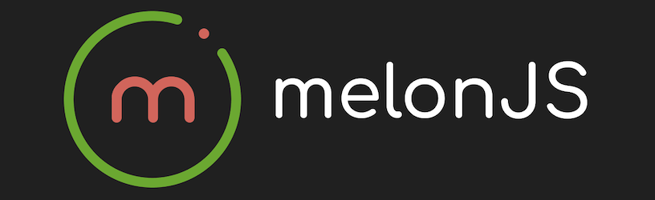

# @melonjs/rapier2d-adapter



[](https://github.com/melonjs/melonJS/blob/master/LICENSE)
[](https://www.npmjs.com/package/@melonjs/rapier2d-adapter)

A [Rapier](https://rapier.rs) 2D physics adapter for melonJS. Rapier is a rigid-body engine written in Rust and compiled to WebAssembly: it handles many bodies at once, has continuous collision detection per body, joints and a character controller, and simulates the same way every time for a given build.

The adapter implements the same `PhysicsAdapter` interface as the built-in physics and the matter and planck adapters. The `bodyDef`s, the collision hooks and the portable calls (`setVelocity`, `raycast`, `queryAABB`, …) of a game written for one of them run here unchanged; only the numbers that depend on units need a look (see [Porting](#porting-from-the-other-adapters)).

## Installation

```bash
npm install @melonjs/rapier2d-adapter
```

[`@dimforge/rapier2d-compat`](https://www.npmjs.com/package/@dimforge/rapier2d-compat) is a regular dependency of the adapter, so it is installed with it. It is Rapier's build with its WebAssembly embedded in the JavaScript, so it works with any bundler, a CDN or plain ES modules, with nothing to configure. The only peer dependency is `melonjs` 20.0 or later.

> **Node 24+** is required at install time, as for every melonJS package. The runtime is the browser.

## Usage

Create the adapter with `RapierAdapter.create()` and pass it as the `physic` option when constructing your `Application`:

```ts
import { RapierAdapter } from "@melonjs/rapier2d-adapter";
import { Application, video } from "melonjs";

const app = new Application(800, 600, {
    parent: "screen",
    renderer: video.AUTO,
    physic: await RapierAdapter.create({
        gravity: { x: 0, y: 320 },
    }),
});

// mandatory since melonJS 20.0: the renderer is built here
await app.init();
```

Every renderable that declares a `bodyDef` is registered with Rapier on `Container.addChild`, and the rest of the game code talks to the shared `PhysicsAdapter` interface.

### Loading Rapier

Rapier's WebAssembly has to be compiled before an adapter can be constructed. The adapter has the static pair every melonJS adapter shares:

- `RapierAdapter.load()` downloads and compiles it, and resolves when it is ready. Every call returns the same promise, so it can be started early and awaited anywhere. A failed load (offline, a blocked chunk) rejects, and the next call tries again.
- `RapierAdapter.create(options)` waits for `load()`, then constructs the adapter. It is the usual way to make one.
- `RapierAdapter.loaded` is `true` once `load()` has finished.

`new RapierAdapter(options)` works too, once Rapier is loaded; called before, it throws and says which call to use instead.

Rapier is imported with `import()`, so bundlers put it (about 3 MB, before compression) in a chunk of its own, downloaded when `load()` is first called. To have it ready without delaying the start, load it alongside the game's assets:

```ts
const rapierReady = RapierAdapter.load(); // starts downloading and compiling now
await loader.preload(assets);             // the assets download in parallel
await rapierReady;
app.world.setAdapter(new RapierAdapter());
```

### Options

The options go in the `RapierAdapter.create({ ... })` call you pass as `physic` above. They are all optional; this is that call with each one at its default:

```ts
physic: await RapierAdapter.create({
    gravity: { x: 0, y: 320 },  // pixels per second², ≈ 10 m/s² pulling down
    pixelsPerMeter: 32,
    subSteps: 1,
}),
```

`gravity` can also change while the game runs: the adapter reads `app.world.adapter.gravity` at every step, so `app.world.adapter.gravity.set(0, 160)` halves it from the next one. The other options cannot change on a live adapter. To change them, switch to a new one with `app.world.setAdapter(await RapierAdapter.create({ ... }))`, which rebuilds every body from its `bodyDef`, at rest. Rapier's own settings, such as the solver iterations, stay writable on `adapter.world.integrationParameters`.

#### `gravity`

In **pixels per second²**, not meters. The adapter converts it with `pixelsPerMeter`.

#### `pixelsPerMeter`

Rapier is tuned for objects about a meter across, so the adapter works in **meters** and converts at every boundary (positions, velocities, gravity, forces, queries). The default `32` makes a 32×32 sprite one meter. Raising it makes every body smaller in meters, so lighter (mass is density × area in m²), and the same force or impulse moves it further; motion under gravity alone looks the same in pixels. Pick it once and keep it.

#### `subSteps`

Divides each frame into `N` Rapier steps of `dt / N` seconds. More sub-steps make fast contacts and tall stacks more accurate, at about `N` times the physics cost. Unlike the matter and planck adapters, a force applied once in a frame acts across all the sub-steps, so raising `subSteps` does not weaken it. For a fast body, turning on continuous collision detection for it is usually the better fix (see [Rapier features](#rapier-features)).

## Collision Events

The adapter dispatches Rapier's collision events to the renderable hooks:

```ts
class Player extends Sprite {
    // once, when two bodies begin to touch
    onCollisionStart(response, other) { /* stomp, pickup, trigger entry */ }

    // once per frame while they keep touching
    onCollisionActive(response, other) { /* sustained damage, conveyor */ }

    // once, when they separate, or when the other body is removed
    onCollisionEnd(response, other) { /* left the platform, exited a zone */ }
}
```

Implement only the ones you need. The same hooks fire on the built-in, matter and planck adapters. A renderable without `onCollisionActive` gets the legacy `onCollision(response, other)` instead, each frame while its body touches another; its return value is ignored.

Rapier reports contacts per pair of colliders, and every melonJS shape is a collider (a concave polygon is one per triangle), so a body touching another through two of its shapes gets the hooks twice. The shape-level hooks, `onShapeCollisionStart`, `onShapeCollisionActive` and `onShapeCollisionEnd`, report each pair of shapes: `contact.shapeA` / `contact.indexShapeA` name your own shape, `contact.shapeB` / `contact.indexShapeB` the other body's.

### The `response` object

```ts
response = {
    a:      Renderable,              // this renderable (the one whose handler is firing)
    b:      Renderable,              // the other renderable
    normal: { x: number, y: number },// unit vector: the direction `a` must move to separate from `b`
    depth:  number,                  // how deep the two overlap, in pixels (never negative)
    pair:   { collider1, collider2 },// the two Rapier collider handles, for `adapter.world.getCollider()`
}
```

In canvas coordinates (y grows downward), `normal.y < -0.7` means "push me up", so I landed on top of `other`. A sensor contact has no contact normal, and neither does a pair in `onCollisionEnd`: there `normal` is `(0, 0)` and `depth` is `0`.

## Body helper methods

`renderable.body` is the Rapier `RigidBody`, with the portable melonJS helpers added to it, so code written for another adapter keeps working:

```ts
body.setVelocity(x, y)                  // pixels per second
body.getVelocity(out?)
body.applyForce(x, y, pointX?, pointY?) // for this frame; off-centre, it also turns the body
body.applyImpulse(x, y)                 // an instant change of velocity: Δv = J / mass
body.setAngle(rad) / body.getAngle()
body.setAngularVelocity(w) / body.getAngularVelocity() // radians per second
body.applyTorque(t)                     // for this frame
body.setStatic(isStatic?)
body.setSensor(isSensor?)
body.setGravityScale(scale)
body.setMass(kg)                        // scales every shape's density
body.setBounce(restitution)
body.collisionType / body.collisionMask // read the first shape's values, write every shape's
```

The adapter has the same operations as `app.world.adapter.X(renderable, ...)`, except `setMass` and `setBounce`. Rapier's own methods stay available on the body: type it as `RapierAdapter.Body` to reach them.

```ts
const body = this.body as RapierAdapter.Body;
body.enableCcd(true);
body.linvel(); // meters per second
```

**Units.** Velocities are in pixels per second and angular velocities in radians per second, as on the planck adapter. `applyForce(x, y)` accelerates a body by `(x, y) / mass` px/s², and a 32×32 box at the default density weighs 1 at the default scale. A force or torque lasts for the frame it is applied in, so apply it every frame for a sustained push; for a jump or a dash use `setVelocity` or `applyImpulse`.

**Move a body with `adapter.setPosition()`.** The adapter writes `renderable.pos` from the Rapier body after every step, so a value written to `pos` directly is undone on the next frame.

## Raycasting and region queries

```ts
adapter.raycast(from: Vector2d, to: Vector2d) → RaycastHit | null
adapter.queryAABB(rect: Rect) → Renderable[]
```

`raycast` returns the first body along the segment, as `{ renderable, point, normal, fraction }`: the hit point in pixels, the surface normal there, and how far along the segment it is (0 to 1). A body the ray starts inside is skipped, so a body casting from its own centre does not hit itself. Sensors are hit like any other body.

`queryAABB` returns every renderable with a body overlapping the rectangle, once each, from the colliders' bounding boxes. A renderable without a body is never returned.

Rapier indexes bodies for these queries when its world steps, so a body added this frame is found from the next frame on, as on the built-in adapter.

## Shapes

| melonJS shape | Rapier collider | notes |
|---|---|---|
| `Rect` | box | exact |
| convex `Polygon`, `RoundRect` | convex polygon | exact, with all its points |
| concave `Polygon` | one triangle per triangle of the outline | exact |
| `Ellipse` | circle | of the average of the two radii |
| `Line` on a static or kinematic body | segment | exact: the usual Tiled polyline terrain |
| `Line` on a dynamic body | 2px quad along it | a segment has no area, so it would give the body no mass |
| a degenerate `Polygon` (collinear points) | its bounding box | |
| `Point`, `Box3d`, `Sphere` | refused | throws: a point has no area, and the 3D shapes need the built-in adapter |

`adapter.getBodyShapes(renderable)` reports the geometry Rapier simulates, at the body's current position and rotation: the debug panel draws it.

## Body Definitions

```ts
this.bodyDef = {
    type: "dynamic",            // "static" | "dynamic" | "kinematic"
    shapes: [ /* see above */ ],
    collisionType?: number,     // default PLAYER_OBJECT (0x0001)
    collisionMask?: number,     // default ALL_OBJECT
    isSensor?: boolean,
    density?: number,           // kg/m², default 1
    friction?: number,          // surface friction, default 0.2
    restitution?: number,       // bounce, default 0
    frictionAir?: number,       // damping per second, of movement and rotation; { x, y } is averaged
    gravityScale?: number,      // default 1
    fixedRotation?: boolean,    // default false: the body rotates
    maxVelocity?: { x, y },     // pixels per second, clamped after each frame
};
```

- **`kinematic`** is a real Rapier kinematic body, moved by its velocity (`setVelocity`) and unaffected by gravity: a moving platform. On the built-in and matter adapters it falls like a dynamic body.
- **A shape's own settings.** A shape can carry `collisionType`, `collisionMask`, `isTrigger` (a sensor) and `isActive` (`false` builds no collider for it), which override the body's for that shape.
- **The body origin** is the first shape's centre, so a body rotates about the middle of what it looks like; `renderable.pos` stays where its `anchorPoint` puts it.

### Collision filtering

melonJS collision types and masks are 32 bits wide, where Rapier's collision groups hold 16. The adapter filters every pair on the full 32 bits: a collider whose type and mask fit in 16 bits is filtered by Rapier natively, and one using a user type from bit 16 up (`collision.types.USER << 9` and beyond) is filtered by a Rapier physics hook instead. Either way, a filtered pair never touches and reports no events.

```ts
body.collisionType = collision.types.PLAYER_OBJECT;
app.world.adapter.setCollisionMask(renderable, collision.types.ENEMY_OBJECT | collision.types.WORLD_SHAPE);
```

A body with no `collisionType` is `PLAYER_OBJECT`, as on the matter and planck adapters, where the built-in adapter defaults to `ENEMY_OBJECT`: set it on any body whose filtering matters.

## Rapier features

For what the portable interface does not cover, the adapter exposes Rapier itself: `adapter.rapier` is the Rapier module, and `adapter.world` the Rapier world. Code that uses them is Rapier-only; to branch without importing the class, test `app.world.physic === "rapier"`.

```ts
const adapter = app.world.adapter as RapierAdapter;
const { rapier, world } = adapter;

// continuous collision detection, for a fast body that must not pass
// through a thin one
(bullet.body as RapierAdapter.Body).enableCcd(true);

// a hinge between two bodies, at their centres (in meters, body-local)
const params = rapier.JointData.revolute({ x: 0, y: 0 }, { x: 0, y: 0 });
world.createImpulseJoint(
    params,
    door.body as RapierAdapter.Body,
    frame.body as RapierAdapter.Body,
    true,
);

// Rapier's kinematic character controller, with a 0.01 m skin
const controller = world.createCharacterController(0.01);
```

Rapier's other joint types are `JointData.fixed`, `spring`, `rope` and `prismatic`. Bodies sleep when they come to rest and wake on contact; `body.sleep()` and `body.wakeUp()` force it. Rapier gives the same simulation for the same inputs on the same build and platform; bit-identical results across platforms need Rapier's separate `-deterministic` build, which this adapter does not use.

Rapier's objects live in WebAssembly memory, which the garbage collector does not reclaim. The adapter frees them in `destroy()`, which `app.world.setAdapter()` calls on the adapter it replaces. Free a joint or a character controller you created yourself with `world.removeImpulseJoint()` / `world.removeCharacterController()`.

## Porting from the other adapters

The `bodyDef`s and hooks carry over. What changes:

- **Velocities are in pixels per second**, as on planck, where the built-in and matter adapters use pixels per step (60 steps a second): multiply their `setVelocity` and `maxVelocity` values by 60.
- **`frictionAir` is a damping rate per second**, of movement and rotation, as on planck. matter removes that fraction every step, and the built-in subtracts it per axis every step, so re-tune it.
- **Forces act for the frame they are applied in**, across every sub-step. They act on the body's mass in kilograms, so re-tune force magnitudes from the built-in adapter.
- **Concave polygons are exact**, where planck replaces one with its convex hull.
- **`isGrounded`** counts a touching contact that pushes the body up: slopes up to about 84° count, walls do not. A sensor contact counts when the sensor's centre is below the body's.
- **Pausing stops the whole simulation**, as on matter and planck; the built-in adapter keeps moving a renderable with `updateWhenPaused`.
- **`updateShape()` builds a new body** from the `bodyDef`: the velocity carries over; the angle, joints and anything changed at run time do not.

## Examples

The [Physics Shapes](https://melonjs.github.io/melonJS/examples/#/physics-shapes) example runs one shape file on all four backends, and switches between them with `world.setAdapter()`; its "rapier" button loads Rapier in the background at start.

## License

MIT. Rapier itself is distributed under the Apache 2.0 license.
